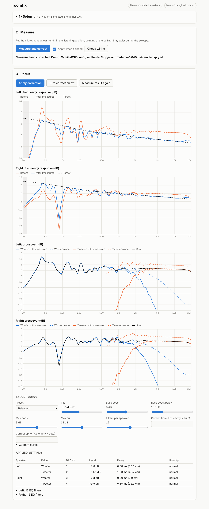

# roomfix

Fully automatic speaker and room correction for Windows. One button measures
your speakers, computes the correction and applies it to everything you play.

- **Room correction** to a target curve you choose (not just flat), with the
  measured, target and corrected curves on screen.
- **Time alignment** of speakers, and of the drivers inside each speaker.
- **Active 2-way and 3-way crossovers** on a multichannel DAC (e.g. Topping
  DM7), with driver protection built in.
- **Subwoofer** with bass management, level, delay and polarity set
  automatically, even when it hangs on a **different output device** than the
  speakers (say, speakers on the TV over HDMI and the subwoofer on a USB DAC).
  The delay between the two devices is measured and compensated.
- Needs only a DAC and a measurement microphone (calibration file supported).



## Install

1. Download `roomfix.exe` from [Releases](../../releases) and run it. A page
   opens in your browser.
   (Or from source: `pip install .` then `roomfix`.)
2. Pick a playback engine:
   - **CamillaDSP** (default, required for active crossovers). roomfix
     downloads and runs it for you. Install [VB-CABLE](https://vb-audio.com/Cable/)
     and make "CABLE Input" the default Windows output; roomfix sends that
     audio, corrected, to the DAC. Set the cable and the DAC to 48 kHz in
     Windows sound settings.
   - **Equalizer APO** (passive speakers only). Install it and enable it for
     the DAC. No virtual cable needed.

No hardware at hand? `roomfix --demo` runs everything against simulated speakers.

## Use

1. **Setup**: choose DAC, microphone and calibration file, and say which DAC
   channel drives which speaker (or driver).
2. **Measure and correct**: place the microphone at the listening position
   and press the button. roomfix sets the levels, measures every driver,
   designs the correction, measures the result and switches it on.
3. **Result**: adjust the target curve (tilt, bass boost, limits, or your own
   curve) or the crossover; the correction updates instantly, without
   measuring again. Press **Apply correction** to use it.

Using several microphone positions (Setup) makes the correction valid for a
wider listening area.

## Subwoofer and a second output device

Tick **Use a subwoofer** in Setup and say where it is connected: a free channel
of the DAC, or another output device. Every speaker is then high-passed at the
subwoofer crossover and the subwoofer plays the bass of all of them.

Two output devices never have the same latency (an HDMI TV is easily 70 ms
slower than a USB DAC), so music played to both arrives out of step. roomfix
runs one playback engine per device, plays a timing chirp to a speaker and a
sweep to the subwoofer through the system audio path, exactly as music will
travel, and delays the faster device by the difference. Afterwards it measures
each speaker together with the subwoofer through the running engines.

- The subwoofer has its own "loudest allowed test signal", because its
  amplifier is separate from the speakers'.
- After measuring, leave the Windows volume of both output devices and the
  volume controls of TV, amplifier and subwoofer where they are: they set the
  balance between speakers and subwoofer. Listen louder or quieter with the
  Windows volume of the virtual cable (the normal volume keys).
- After the engines start (at login, when you press Apply, or when a device
  returns), the devices need up to a minute to settle into exact alignment.
- Known limit: the latency of an output device can differ by a few
  milliseconds from one engine start to the next. roomfix measures the result
  through the running engines and warns if subwoofer and speakers do not add
  up as predicted at the crossover.

Test signals are played in Windows shared mode, so the bit depth and sample
rate a device is set to do not matter for measuring. In a noisy room, the
subwoofer is only corrected down to the frequency where it is louder than the
room's own rumble.

## Always on, and volume

With CamillaDSP, a small background process (`roomfix --engine`) looks after the
correction. roomfix starts it when you press Apply and, with "Start correction
with Windows", at login. The roomfix page does not need to be open.

- If an output device disappears (a TV that is switched off, a DAC that is
  unplugged), its engine stops. The background process waits for the device and
  starts the engine again within a few seconds of its return, also when Windows
  has renamed the device meanwhile ("1 - LG TV" to "2 - LG TV"). An engine that
  fails for another reason is restarted too, with growing pauses.
- The page shows a volume slider and a mute button while the correction runs,
  and tells you which device it is waiting for. The volume is the same on all
  output devices, is remembered, and never goes above 0 dB.
- Hotkey scripts can use the same local API (the port is in
  `%APPDATA%
oomfix\engine.json`, normally 8136), with `Content-Type: application/json`:
  `POST /api/volume {"delta": -2}` or `{"value": -20}`, `POST /api/mute {}` (toggle),
  `POST /api/restart {}`, `GET /api/status`.

## Active crossovers and driver safety

For each driver above the woofer you enter its **lowest safe crossover
frequency** (from the data sheet). Then:

- Every test signal for that driver passes a 24 dB/oct high-pass at that
  frequency. A tweeter never receives a full-range sweep.
- A crossover below that frequency is refused.
- Before the first measurement, a wiring check plays a quiet hiss that is
  harmless for any driver, one channel at a time, and asks you to confirm
  that each came from the right driver.
- Levels start very low and rise only until the microphone hears enough,
  never above the limit set in Setup.
- With CamillaDSP, audio reaches the DAC only through the crossover: if the
  engine is not running, the speakers are silent.

Still: keep the amplifier volume low for the first run, and remember that no
software can protect against a miswired amplifier. A capacitor in series with
each tweeter is cheap insurance.

## How it works

| Step | Method |
|---|---|
| Measure | Log sine sweep per driver. A short chirp from one reference driver precedes each sweep, giving exact relative timing without a loopback cable. |
| Crossover | Linkwitz-Riley 12/24/48 dB/oct. Driver levels are matched; delay and polarity are chosen so the drivers sum in phase at the crossover. |
| Speakers | Delay and level are set so all speakers arrive together and equally loud. A speaker wired in reverse is detected and fixed. |
| Subwoofer | Linkwitz-Riley 24 dB/oct against all speakers. Level matched to the speakers; delay and polarity chosen so that it adds up with them at the crossover. |
| Two devices | The latency of a CamillaDSP engine is its chunk plus its buffer level; all engines are held at the same level. The remaining difference between the devices is measured through the engines and removed with a delay. |
| EQ | Up to 20 peaking filters per speaker. Peaks are cut precisely; only broad dips are filled; boost is limited; nothing is corrected outside the speaker's range. |
| Apply | Written as a CamillaDSP or Equalizer APO configuration. Exported filters are tested against the built-in simulation to be identical. |

Settings and measurements are stored in `%APPDATA%\roomfix`.

## Limits

- Stereo or multi-speaker setups with 1 to 3 ways each, plus one subwoofer.
- Only the subwoofer can be on a second output device, and it needs the CamillaDSP engine.
- 48 kHz processing, minimum-phase (IIR) correction.

## Development

```
pip install -e .[dev]
pytest
```

The tests run the whole pipeline against a simulated room (`roomfix/sim.py`).
MIT license. CamillaDSP and Equalizer APO are separate projects under their own licenses.
